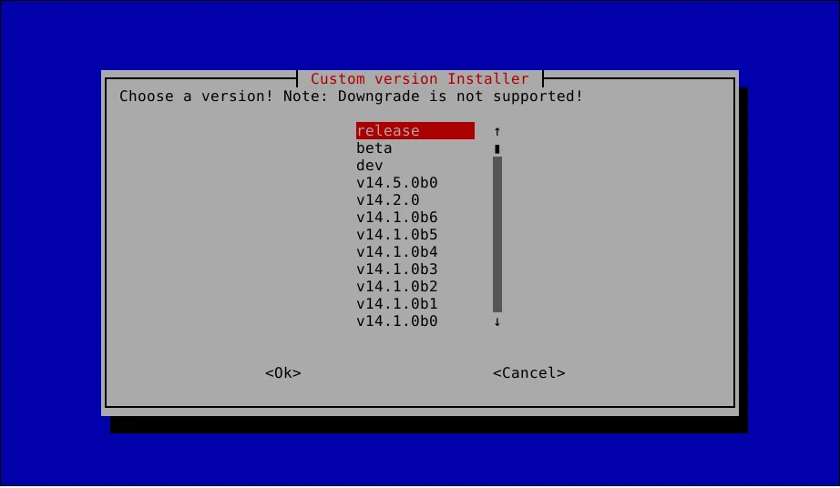

<div dir="rtl" markdown="1">


# نصب نسخه‌های مختلف هیدیفای‌منیجر
همانطور که می‌دانید، هیدیفای‌منیجر در سه نسخه ارائه می‌گردد که به شرح زیر است:
* **نسخه در حال توسعه یا دولوپ:** 

این نسخه نسخه‌ای از نرم‌افزار است که در حال توسعه برای ایجاد آخرین قابلیت‌هاست. ممکن است این نسخه دارای باگ باشد بنابراین بهتر است روی سرورهای تستی نصب گردد.
* **نسخه بتا:** 

این نسخه یک ورژن بعد از نسخه در حال توسعه است و در حقیقت نسخه قبل از انتشار نهایی است که در آن بخشی از باگ‌ها رفع شده است و دارای قابلیت‌های جدید می‌باشد.
* **نسخه پایدار یا ریلیز:** 

این نسخه در حقیقت ورژن نهایی از نرم‌افزار است که پس از تست‌های نهایی منتشر شده است و پایدارترین نسخه ممکن است.
برای درک بهتر این شکل را ملاحظه فرمایید.

<div align=center markdown="1">


</div>

## نصب نسخه پایدار (ریلیز)
* قبل از نصب اگر از قبل نسخه دیگری از پنل را نصب کرده‌اید، یک بکاپ از پنل بگیرید. [بیشتر بخوانید ...](/fa/manager/configuration-and-advanced-settings/How-to-backup-and-restore-panel-on-Hiddify/)
* حالا کافیه دستور تک خطی زیر را در ترمینال اجرا نمایید.


<div dir=ltr>

```
bash <(curl https://i.hiddify.com/release)
```

</div>

* پس از نصب، کافیه بکاپ خود را برگردانید. [بیشتر بخوانید ...](/fa/manager/configuration-and-advanced-settings/How-to-backup-and-restore-panel-on-Hiddify/)


## نصب نسخه بتا
* قبل از نصب اگر از قبل نسخه دیگری از پنل را نصب کرده‌اید، یک بکاپ از پنل بگیرید. [بیشتر بخوانید ...](/fa/manager/configuration-and-advanced-settings/How-to-backup-and-restore-panel-on-Hiddify/)
* حالا کافیه دستور تک خطی زیر را در ترمینال اجرا نمایید.

<div dir=ltr>

```
bash <(curl https://i.hiddify.com/beta)
```

</div>

* پس از نصب، کافیه بکاپ خود را برگردانید. [بیشتر بخوانید ...](/fa/manager/configuration-and-advanced-settings/How-to-backup-and-restore-panel-on-Hiddify/)


## نصب نسخه در حال توسعه (دولوپ)
* قبل از نصب اگر از قبل نسخه دیگری از پنل را نصب کرده‌اید، یک بکاپ از پنل بگیرید. [بیشتر بخوانید ...](/fa/manager/configuration-and-advanced-settings/How-to-backup-and-restore-panel-on-Hiddify/)
* حالا کافیه دستور تک خطی زیر را در ترمینال اجرا نمایید.

<div dir=ltr>

```
bash <(curl https://i.hiddify.com/dev)
```

</div>


* پس از نصب، کافیه بکاپ خود را برگردانید. [بیشتر بخوانید ...](/fa/manager/configuration-and-advanced-settings/How-to-backup-and-restore-panel-on-Hiddify/)

## نصب نسخه دلخواه
این قابلیت وجود دارد که یک نسخه دلخواه را نصب کنید. کافیست طبق دستور زیر عمل کنید.


<div dir=ltr>

```
bash <(curl https://i.hiddify.com/vVERSION)
```
</div>

که در اینجا به جای VERSION باید نسخه مورد نظر خود را وارد کنید. فرض کنید نسخه `8` را می‌خواهید نصب کنید. کافیست دستور زیر را اجرا نمایید تا آخرین نسخه `8` برای شما نصب شود.

<div dir=ltr>

```
bash <(curl https://i.hiddify.com/v8)
```
</div>

!!! warning "هشدار"
    نسخهٔ ۸ خیلی قدیمی است و دیگر به‌روزرسانی امنیتی نمی‌گیرد. فقط اگر واقعاً لازم دارید از آن استفاده کنید؛ برای سرور جدید، آخرین نسخه را نصب کنید.

از نسخه 10 می‌توانید دقیقا یک آپدیت خاص را نصب نمایید. به عنوان مثال برای نصب نسخه `14.0.5` کافیست از دستور زیر استفاده نمایید.

<div dir=ltr>

```
bash <(curl https://i.hiddify.com/v14.0.5)
```
</div>

!!! warning "برگشت به نسخهٔ قدیمی‌تر پشتیبانی نمی‌شود"
    نصب نسخهٔ قدیمی‌تر روی نسخهٔ جدیدتر پشتیبانی نمی‌شود. برای برگشت به نسخهٔ قدیمی‌تر، از پنل پشتیبان بگیرید، آن را [کامل حذف کنید](/fa/manager/configuration-and-advanced-settings/How-to-Reset-Hiddify-panel-to-default/)، نسخهٔ قدیمی‌تر را نصب کنید و پشتیبان را بازیابی کنید (ممکن است پشتیبانِ نسخهٔ جدیدتر روی نسخهٔ قدیمی‌تر بازیابی نشود).

همچنین می‌توان نسخه‌های دلخواه با اجرای دستور زیر به صورت منوی گرافیکی مشاهده نمود و برای نصب انتخاب کرد.

<div dir=ltr>

```
bash <(curl https://i.hiddify.com/custom)
```
</div>

که در نتیجه این منوی گرافیکی (*Custom version Installer*) ظاهر می‌شود. نسخه مورد نظر خود را انتخاب نمایید تا نصب انجام شود. با کلیدهای جهت جابه‌جا شوید، روی نسخه `Enter` بزنید و `<Ok>` را انتخاب کنید.



## تغییر نسخهٔ سرور نصب‌شده به Release یا Beta { #switch }
روی سروری که هیدیفای‌منیجر نصب است، نیازی به نصب دوباره نیست:

- در پنل: در **تنظیمات** و کارت **تنظیمات پیشرفته**، تنظیم **حالت به‌روزرسانی** (Package Update Mode) تعیین می‌کند به‌روزرسانی‌ها از نسخهٔ Release بیایند یا Beta. بعد در صفحهٔ **اقدامات** روی **به‌روزرسانی** بزنید.
- روی سرور: دستور `hiddify upgrade release` یا `hiddify upgrade beta` (و `hiddify upgrade dev` برای نسخهٔ در حال توسعه).

## مقاله‌های مرتبط

- [نصب روی داکر](/fa/manager/installation-and-setup/Install-Hiddify-using-Docker/)
- [نصب خودکار از پنل دیتاسنتر (Cloud-init)](/fa/manager/installation-and-setup/Cloud-init-installation/)
- [پیش‌نیازهای نصب](/fa/manager/installation-and-setup/Installation-prerequisites/)
- [اتصال به سرور با SSH](/fa/manager/installation-and-setup/How-to-connect-to-server-via-SSH/)

</div>
