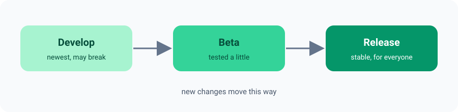
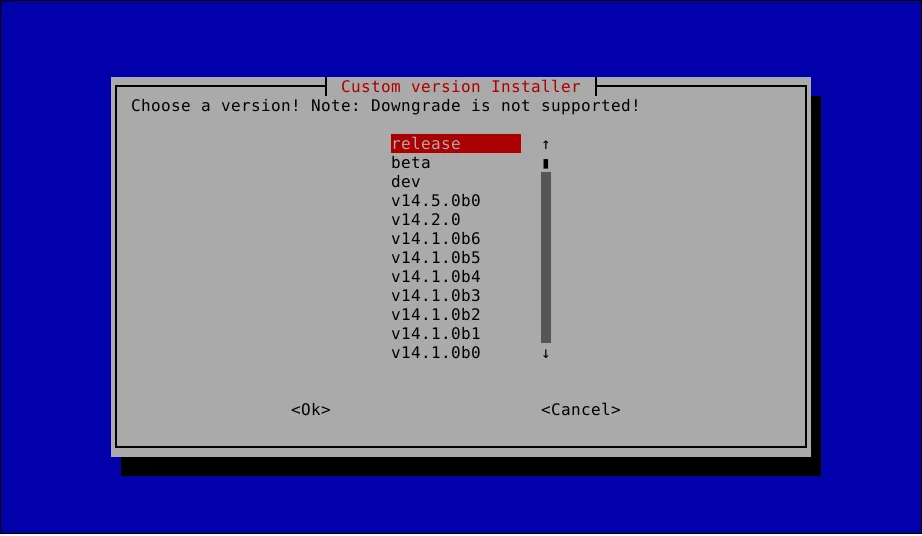

<div dir="ltr" markdown=1>

# How to install different versions of HiddifyManager
As you know, HiddifyManager is offered in three versions as follows:

* **Develop version:**

This version is a version of the software that is being developed to create the latest features. This version may have bugs, so it is better to install it on test servers.

* **Beta version:**
  
This version is a version after the version under development, and in fact it is the version before the final release, in which part of the bugs have been fixed and it has new features.

* **Release version:**

This version is actually the final version of the software that was released after the final tests and is the most stable version possible. See this figure for a better understanding.

<div align=center markdown=1>
  


</div>

## Install Release version
* Before installing, if you have already installed another version of the panel, take a backup of the panel. [Read more...](/manager/configuration-and-advanced-settings/How-to-backup-and-restore-panel-on-Hiddify/)
* Now just run the following one-line command in the terminal.

```
bash <(curl https://i.hiddify.com/release)
```

* After installation, just restore your backup. [Read more...](/manager/configuration-and-advanced-settings/How-to-backup-and-restore-panel-on-Hiddify/)


## Install Beta version
* Before installing, if you have already installed another version of the panel, take a backup of the panel. [Read more...](/manager/configuration-and-advanced-settings/How-to-backup-and-restore-panel-on-Hiddify/)
* Now just run the following one-line command in the terminal.

```
bash <(curl https://i.hiddify.com/beta)
```

* After installation, just restore your backup. [Read more...](/manager/configuration-and-advanced-settings/How-to-backup-and-restore-panel-on-Hiddify/)


## Install Develop version
* Before installing, if you have already installed another version of the panel, take a backup of the panel. [Read more...](/manager/configuration-and-advanced-settings/How-to-backup-and-restore-panel-on-Hiddify/)
* Now just run the following one-line command in the terminal.

```
bash <(curl https://i.hiddify.com/dev)
```

* After installation, just restore your backup. [Read more...](/manager/configuration-and-advanced-settings/How-to-backup-and-restore-panel-on-Hiddify/)

## Install the desired version
It is possible to install a custom version. Just follow the instructions below.


```
bash <(curl https://i.hiddify.com/vVERSION)
```

Here, instead of VERSION, you should enter the desired version. Suppose you want to install version `8`. Just execute the following command to install the latest version `8` for you.

```
bash <(curl https://i.hiddify.com/v8)
```

!!! warning
    Version 8 is very old and no longer gets security fixes. Use it only if you really need it; for a new server, install the latest version.

From version 10, you can install exactly one specific update. For example, to install version `14.0.5`, just use the following command.

```
bash <(curl https://i.hiddify.com/v14.0.5)
```

!!! warning "Downgrade is not supported"
    Installing an older version over a newer one is not supported. To go back to an older version, back up the panel, [remove it completely](/manager/configuration-and-advanced-settings/How-to-Reset-Hiddify-panel-to-default/), install the older version and restore the backup (a backup from a newer version may not restore on an older one).

</div>

You can also view and select desired versions for installation via a graphical menu by running the following command:

<div dir=ltr>

```
bash <(curl https://i.hiddify.com/custom)
```
</div>

This will result in the appearance of a graphical menu (*Custom version Installer*). Select your desired version to proceed with the installation. Move with the arrow keys, press `Enter` on a version, and choose `<Ok>`.



## Switch an installed server to Release or Beta { #switch }
On a server that already runs HiddifyManager, you do not need to reinstall:

- In the panel: **Settings** › **Advanced Settings** › **Package Update Mode** chooses whether updates come from the Release or the Beta channel. Then update from **Actions** › **Update**.
- On the server: `hiddify upgrade release` or `hiddify upgrade beta` (`hiddify upgrade dev` for the develop version).

## Related articles

- [Install with Docker](/manager/installation-and-setup/Install-Hiddify-using-Docker/)
- [Automatic install from the data center (Cloud-init)](/manager/installation-and-setup/Cloud-init-installation/)
- [Installation prerequisites](/manager/installation-and-setup/Installation-prerequisites/)
- [Connect to your server with SSH](/manager/installation-and-setup/How-to-connect-to-server-via-SSH/)
