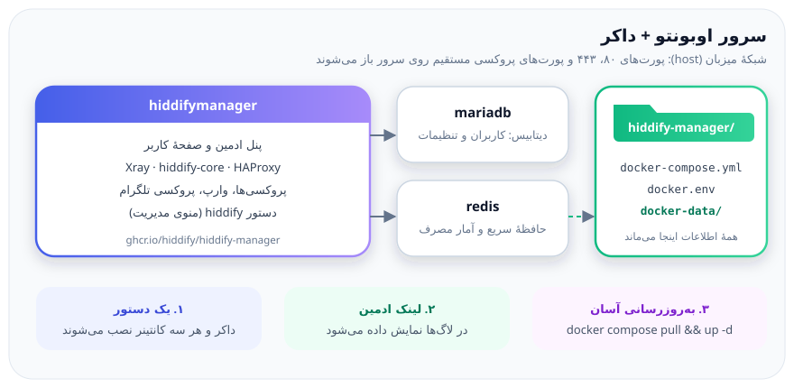
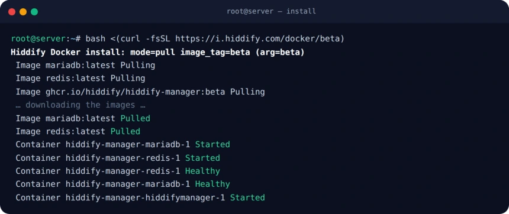
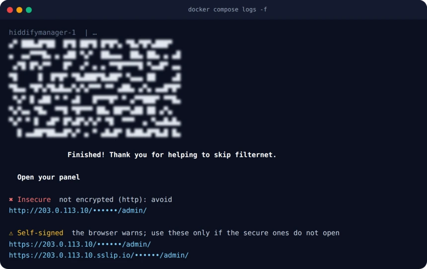
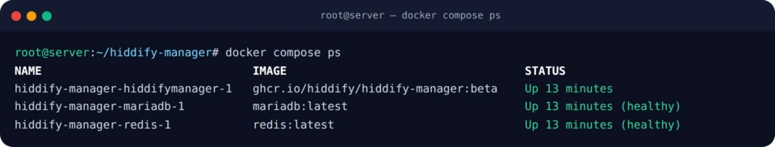
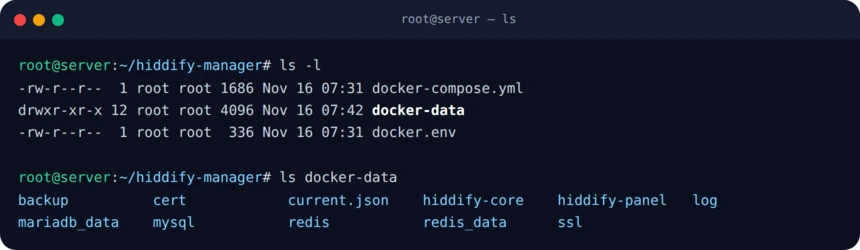
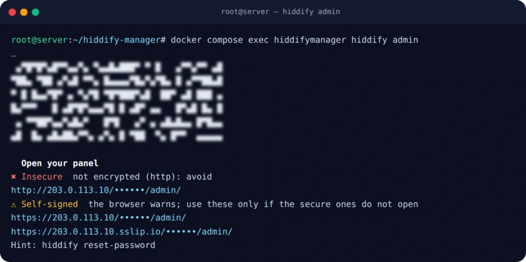

# نصب هیدیفای‌منیجر روی داکر

به‌جای نصب مستقیم هیدیفای‌منیجر روی سرور، می‌توانید آن را در **داکر** (Docker) اجرا کنید. داکر برنامه‌ها را در محفظه‌های جداگانه‌ای به اسم **کانتینر** اجرا می‌کند. هیدیفای‌منیجر، دیتابیس و Redis هر کدام در کانتینر خودشان اجرا می‌شوند و همهٔ اطلاعات در یک پوشه می‌ماند؛ پس پشتیبان‌گیری، انتقال به سرور دیگر و حذف آن ساده است.

<div align=center markdown=1>



</div>

## داکر یا نصب معمولی؟

| | نصب با داکر | [نصب معمولی](/fa/manager/installation-and-setup/guide/) |
|---|---|---|
| نصب | یک دستور | یک دستور |
| جای اطلاعات | یک پوشه (`docker-data`) | پوشه‌های سیستم |
| انتقال به سرور دیگر | کپی کردن یک پوشه | [پشتیبان‌گیری و بازیابی](/fa/manager/configuration-and-advanced-settings/How-to-backup-and-restore-panel-on-Hiddify/) |
| به‌روزرسانی | `docker compose pull` | از داخل پنل یا منوی `hiddify` |
| مناسب برای | کسی که با داکر کار کرده یا می‌خواهد همه چیز جدا و مرتب بماند | بیشتر کاربران |

## پیش از شروع

- یک سرور با **اوبونتوی** تازه‌نصب، ترجیحاً **26.04** یا **24.04** (22.04 فقط اگر نسخهٔ جدیدتری در دسترس نبود). [پیش‌نیازهای نصب](/fa/manager/installation-and-setup/Installation-prerequisites/) را ببینید.
- کل سرور را به هیدیفای‌منیجر اختصاص دهید. کانتینر هیدیفای‌منیجر از شبکهٔ خود سرور (host) استفاده می‌کند و پورت‌های ۸۰ و ۴۴۳ و پورت‌های پروکسی را مستقیم باز می‌کند، پس با وب‌سرورهای دیگر روی همان سرور تداخل پیدا می‌کند.
- با کاربر `root` [از طریق SSH به سرور وصل شوید](/fa/manager/installation-and-setup/How-to-connect-to-server-via-SSH/).

لازم نیست داکر را خودتان نصب کنید. اگر نصب نباشد، اسکریپت آن را نصب می‌کند.

## نصب

به پوشه‌ای بروید که می‌خواهید هیدیفای‌منیجر در آن نگه داشته شود (مثلاً پوشهٔ خانگی، با `cd ~`) و یکی از این دستورها را اجرا کنید.

=== "پایدار (پیشنهادی)"

    ```bash
    bash <(curl -fsSL https://i.hiddify.com/docker/latest)
    ```

=== "بتا"

    ```bash
    bash <(curl -fsSL https://i.hiddify.com/docker/beta)
    ```

    جدیدتر است و ممکن است باگ داشته باشد.

=== "در حال توسعه"

    ```bash
    bash <(curl -fsSL https://i.hiddify.com/docker/dev)
    ```

    فقط برای تست.

=== "نسخهٔ مشخص"

    ```bash
    bash <(curl -fsSL https://i.hiddify.com/docker/v14.2.0)
    ```

    به‌جای `v14.2.0` نسخهٔ دلخواه را بنویسید.

اسکریپت اول داکر را نصب می‌کند (اگر نصب نباشد)، بعد سه ایمیج را دانلود و سه کانتینر را اجرا می‌کند. دانلود بار اول، بسته به سرعت سرور، چند دقیقه طول می‌کشد:



??? tip "اگر خطای 404 یا failed to read dockerfile دیدید"
    این دستور همان اسکریپت را مستقیم از گیت‌هاب اجرا می‌کند و نسخهٔ پایدار را نصب می‌کند:

    ```bash
    bash <(curl -fsSL https://raw.githubusercontent.com/hiddify/Hiddify-Manager/beta/scripts/common/docker-installer.sh) release
    ```

    اگر پوشهٔ `hiddify-manager` از اجرای قبلی مانده، اول آن را پاک کنید (`rm -rf hiddify-manager`) یا از پوشهٔ دیگری اجرا کنید.

اسکریپت این کارها را انجام می‌دهد:

1. اگر لازم باشد، داکر را نصب می‌کند.
2. پوشه‌ای به نام `hiddify-manager` با فایل‌های `docker-compose.yml` و `docker.env` می‌سازد.
3. برای دیتابیس و Redis رمزهای تصادفی می‌گذارد.
4. ایمیج هیدیفای‌منیجر، MariaDB و Redis را دانلود و هر سه را اجرا می‌کند.
5. لاگ‌ها را نشان می‌دهد.

## گرفتن لینک ادمین

بار اول، کانتینر هیدیفای‌منیجر چند دقیقه خودش را پیکربندی می‌کند. وقتی کار تمام شد، در لاگ‌ها **Finished!** و زیرش **لینک‌های ادمین** نمایش داده می‌شوند:



**لینک ادمین را ذخیره کنید**؛ مثل رمز عبور است. برای بستن نمایش لاگ‌ها `Ctrl+C` را بزنید؛ هیدیفای‌منیجر همچنان اجرا می‌ماند.

!!! note "لینک‌های self-signed"
    تا وقتی دامنه تنظیم نکرده‌اید، فقط لینک‌های آی‌پی (Insecure یا Self-signed) وجود دارند و مرورگر برای لینک self-signed هشدار می‌دهد. بعد از [تنظیم دامنه](/fa/manager/installation-and-setup/Guide-for-setting-up-the-domain-and-finalizing-the-installation/)، لینک امن با گواهی معتبر ساخته می‌شود.

## تکمیل نصب

لینک ادمین را در مرورگر باز کنید. ویزارد **راه‌اندازی سریع** شروع می‌شود؛ بعد دامنه را تنظیم کنید. راهنمای [تنظیم دامنه و نهایی کردن نصب](/fa/manager/installation-and-setup/Guide-for-setting-up-the-domain-and-finalizing-the-installation/) را ببینید.

## داخل محیط داکر

همهٔ دستورهای این بخش را **داخل پوشهٔ `hiddify-manager`** اجرا کنید (`cd ~/hiddify-manager`).

### وضعیت کانتینرها

`docker compose ps` نشان می‌دهد هر سه کانتینر اجرا هستند. MariaDB و Redis وقتی آماده باشند **healthy** نشان داده می‌شوند:



### پوشهٔ هیدیفای‌منیجر

همه چیز در همین پوشه است: `docker-compose.yml` (تعریف کانتینرها)، `docker.env` (تنظیمات و رمزهای دیتابیس) و **`docker-data`** که اطلاعات پنل، دیتابیس، گواهی‌ها، لاگ‌ها و بکاپ‌ها را نگه می‌دارد:



`docker-data` با توقف، ری‌استارت یا به‌روزرسانی کانتینرها پاک نمی‌شود. این پوشه را پاک نکنید، مگر اینکه بخواهید همه چیز حذف شود. برای پشتیبان‌گیری کامل، کافی است از کل پوشهٔ `hiddify-manager` نسخه بگیرید.

### دیدن دوبارهٔ لینک ادمین

اگر لینک ادمین را گم کردید، دستور `hiddify admin` را داخل کانتینر اجرا کنید:



با `docker compose exec hiddifymanager hiddify` (بدون کلمهٔ دیگر) منوی مدیریت هیدیفای باز می‌شود، و با `docker compose exec hiddifymanager bash` وارد خط فرمان داخل کانتینر می‌شوید.

### دستورهای کاربردی

| کار | دستور |
|---|---|
| دیدن وضعیت کانتینرها | `docker compose ps` |
| دیدن لاگ‌ها | `docker compose logs -f` |
| نمایش دوبارهٔ لینک ادمین | `docker compose exec hiddifymanager hiddify admin` |
| منوی مدیریت هیدیفای | `docker compose exec hiddifymanager hiddify` |
| ری‌استارت | `docker compose restart` |
| به‌روزرسانی به جدیدترین نسخه | `docker compose pull && docker compose up -d` |
| توقف | `docker compose down` |
| اجرای دوباره بعد از توقف | `docker compose up -d` |

??? note "دیتابیس یا Redis جداگانه (پیشرفته)"
    اگر می‌خواهید هیدیفای‌منیجر به یک سرور MySQL/MariaDB یا Redis جداگانه وصل شود، به‌جای کانتینرهای داخلی، از فایل `docker-compose.external-db.yml` استفاده کنید. راهنمای آن در [EXTERNAL_DATABASE.md](https://github.com/hiddify/Hiddify-Manager/blob/beta/docs/EXTERNAL_DATABASE.md) است.

## مقاله‌های مرتبط

- [راهنمای نصب اصلی](/fa/manager/installation-and-setup/guide/)
- [نصب نسخه‌های مختلف](/fa/manager/installation-and-setup/How-to-install-different-versions-of-Hiddify-Manager/)
- [نصب خودکار از پنل دیتاسنتر (Cloud-init)](/fa/manager/installation-and-setup/Cloud-init-installation/)
- [پیش‌نیازهای نصب](/fa/manager/installation-and-setup/Installation-prerequisites/)
- [اتصال به سرور با SSH](/fa/manager/installation-and-setup/How-to-connect-to-server-via-SSH/)
