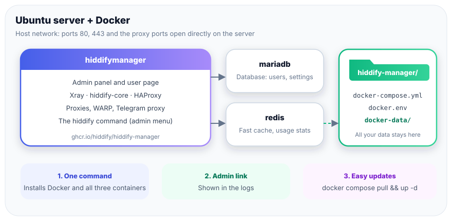
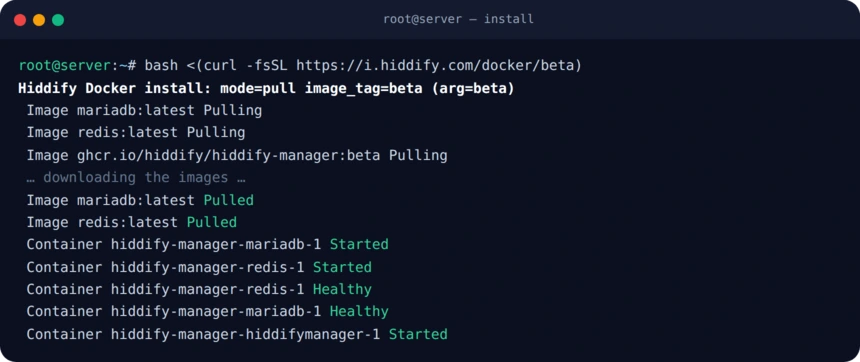
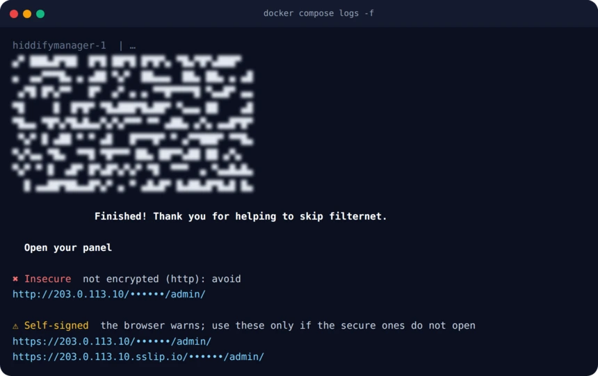
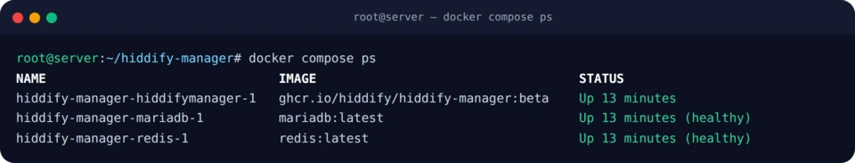
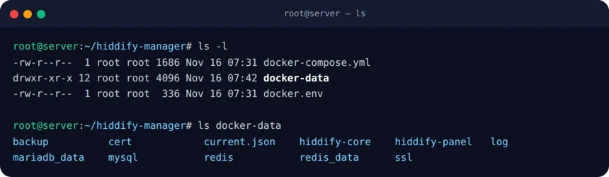
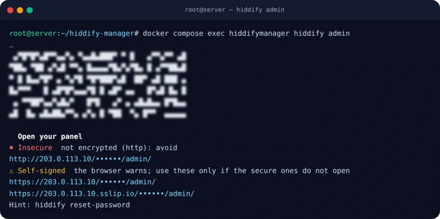

# Installing HiddifyManager using Docker

Instead of installing HiddifyManager directly on your server, you can run it in **Docker**. Docker runs programs in separate boxes called **containers**. HiddifyManager, its database and Redis each run in their own container, and all your data stays in one folder, so backing up, moving to another server and removing it are simple.

<div align=center markdown=1>



</div>

## Docker or the normal install?

| | Docker install | [Normal install](/manager/installation-and-setup/guide/) |
|---|---|---|
| Install | One command | One command |
| Where the data lives | One folder (`docker-data`) | System folders |
| Moving to another server | Copy one folder | [Backup and restore](/manager/configuration-and-advanced-settings/How-to-backup-and-restore-panel-on-Hiddify/) |
| Updating | `docker compose pull` | From the panel or the `hiddify` menu |
| Best for | People who know Docker or want everything kept separate and tidy | Most users |

## Before you start

- A server with a fresh **Ubuntu**, preferably **26.04** or **24.04** (22.04 only if nothing newer is offered). See [Installation prerequisites](/manager/installation-and-setup/Installation-prerequisites/).
- Give the whole server to HiddifyManager. Its container uses the server's own (host) network and opens ports 80 and 443 and the proxy ports directly, so it clashes with other web servers on the same machine.
- [Connect to the server over SSH](/manager/installation-and-setup/How-to-connect-to-server-via-SSH/) as `root`.

You don't need to install Docker yourself. If it is missing, the script installs it.

## Install

Go to the folder where you want to keep HiddifyManager (for example your home folder, with `cd ~`) and run one of these commands.

=== "Stable (recommended)"

    ```bash
    bash <(curl -fsSL https://i.hiddify.com/docker/latest)
    ```

=== "Beta"

    ```bash
    bash <(curl -fsSL https://i.hiddify.com/docker/beta)
    ```

    Newer, and may have bugs.

=== "Development"

    ```bash
    bash <(curl -fsSL https://i.hiddify.com/docker/dev)
    ```

    For testing only.

=== "A specific version"

    ```bash
    bash <(curl -fsSL https://i.hiddify.com/docker/v14.2.0)
    ```

    Put the version you want in place of `v14.2.0`.

The script first installs Docker (if needed), then downloads three images and starts three containers. The first download takes a few minutes, depending on the server's speed:



??? tip "If you see a 404 or failed to read dockerfile error"
    This command runs the same script straight from GitHub and installs the stable version:

    ```bash
    bash <(curl -fsSL https://raw.githubusercontent.com/hiddify/Hiddify-Manager/beta/scripts/common/docker-installer.sh) release
    ```

    If a `hiddify-manager` folder is left from an earlier try, delete it first (`rm -rf hiddify-manager`) or run the command from another folder.

The script does this:

1. Installs Docker if needed.
2. Creates a folder named `hiddify-manager` with the files `docker-compose.yml` and `docker.env`.
3. Sets random passwords for the database and Redis.
4. Downloads the HiddifyManager, MariaDB and Redis images and starts all three.
5. Shows the logs.

## Get your admin link

The first time, the HiddifyManager container configures itself for a few minutes. When it is done, the logs show **Finished!** and, under it, your **admin links**:



**Save your admin link**; it works like a password. Press `Ctrl+C` to stop showing the logs; HiddifyManager keeps running.

!!! note "Self-signed links"
    Until you set up a domain, there are only IP links (Insecure or Self-signed), and the browser warns about the self-signed one. After you [set up a domain](/manager/installation-and-setup/Guide-for-setting-up-the-domain-and-finalizing-the-installation/), a secure link with a valid certificate is created.

## Finish the installation

Open the admin link in your browser. The **Quick Setup** wizard starts; then set up your domain. Follow [Setting up the domain and finalizing the installation](/manager/installation-and-setup/Guide-for-setting-up-the-domain-and-finalizing-the-installation/).

## Inside the Docker setup

Run every command in this section **inside the `hiddify-manager` folder** (`cd ~/hiddify-manager`).

### Container status

`docker compose ps` shows that all three containers are running. MariaDB and Redis show **healthy** when they are ready:



### The HiddifyManager folder

Everything is in this folder: `docker-compose.yml` (the containers), `docker.env` (settings and database passwords) and **`docker-data`**, which keeps the panel data, the database, certificates, logs and backups:



`docker-data` is kept when you stop, restart or update the containers. Don't delete it unless you want to remove everything. For a full backup, copy the whole `hiddify-manager` folder.

### See your admin link again

If you lose your admin link, run the `hiddify admin` command inside the container:



`docker compose exec hiddifymanager hiddify` (with nothing after it) opens the Hiddify management menu, and `docker compose exec hiddifymanager bash` gives you a shell inside the container.

### Useful commands

| Task | Command |
|---|---|
| See the containers' status | `docker compose ps` |
| See the logs | `docker compose logs -f` |
| Show the admin link again | `docker compose exec hiddifymanager hiddify admin` |
| Hiddify management menu | `docker compose exec hiddifymanager hiddify` |
| Restart | `docker compose restart` |
| Update to the latest version | `docker compose pull && docker compose up -d` |
| Stop | `docker compose down` |
| Start again after stopping | `docker compose up -d` |

??? note "A separate database or Redis (advanced)"
    To connect HiddifyManager to your own MySQL/MariaDB or Redis server instead of the built-in containers, use the `docker-compose.external-db.yml` file. It is explained in [EXTERNAL_DATABASE.md](https://github.com/hiddify/Hiddify-Manager/blob/beta/docs/EXTERNAL_DATABASE.md).

## Related articles

- [Main installation guide](/manager/installation-and-setup/guide/)
- [Install other versions](/manager/installation-and-setup/How-to-install-different-versions-of-Hiddify-Manager/)
- [Easy installation through the data center (Cloud-init)](/manager/installation-and-setup/Cloud-init-installation/)
- [Installation prerequisites](/manager/installation-and-setup/Installation-prerequisites/)
- [Connect to your server with SSH](/manager/installation-and-setup/How-to-connect-to-server-via-SSH/)
