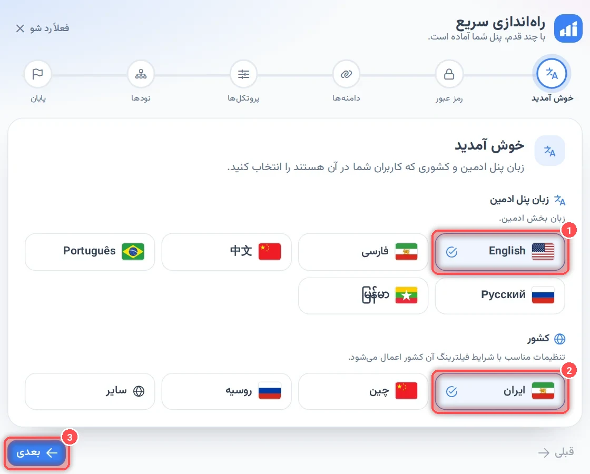

<link rel="stylesheet" href="/assets/install/install.css">

<div dir="rtl" markdown="1" class="hi-install" data-lang="fa">


<div class="hi-hero" markdown="1">

<span class="hi-pill"><i></i>آخرین نسخهٔ پایدار هیدیفای‌منیجر</span>

# یک دستور.<br>یک سرور کامل. { .hi-title }

<p class="hi-lead">هیدیفای‌منیجر روی سرور اوبونتوی شما، پنل مدیریت، ۱۳ سرویس و گواهی امنیتی را خودش نصب می‌کند. شما فقط یک دستور می‌چسبانید.</p>

<div class="hi-cmd" markdown="1">

```bash
bash <(curl https://i.hiddify.com/release)
```

</div>

<div class="hi-facts"><span> اوبونتو ۲۶.۰۴ یا ۲۴.۰۴</span><span><svg aria-hidden="true" xmlns="http://www.w3.org/2000/svg" viewBox="0 0 24 24"><path d="M6 4h12v1h3v2h-3v2h3v2h-3v2h3v2h-3v2h3v2h-3v1H6v-1H3v-2h3v-2H3v-2h3v-2H3V9h3V7H3V5h3V4m5 11v3h1v-3h-1m2 0v3h1v-3h-1m2 0v3h1v-3h-1Z"/></svg> amd64 و arm64</span><span><svg aria-hidden="true" xmlns="http://www.w3.org/2000/svg" viewBox="0 0 24 24"><path d="M12 20a8 8 0 0 0 8-8 8 8 0 0 0-8-8 8 8 0 0 0-8 8 8 8 0 0 0 8 8m0-18a10 10 0 0 1 10 10 10 10 0 0 1-10 10C6.47 22 2 17.5 2 12A10 10 0 0 1 12 2m.5 5v5.25l4.5 2.67-.75 1.23L11 13V7h1.5Z"/></svg> چند دقیقه</span><span><svg aria-hidden="true" xmlns="http://www.w3.org/2000/svg" viewBox="0 0 24 24"><path d="M12 17a2 2 0 0 1-2-2c0-1.11.89-2 2-2a2 2 0 0 1 2 2 2 2 0 0 1-2 2m6 3V10H6v10h12m0-12a2 2 0 0 1 2 2v10a2 2 0 0 1-2 2H6a2 2 0 0 1-2-2V10c0-1.11.89-2 2-2h1V6a5 5 0 0 1 5-5 5 5 0 0 1 5 5v2h1m-6-5a3 3 0 0 0-3 3v2h6V6a3 3 0 0 0-3-3Z"/></svg> گواهی SSL خودکار</span></div>

<div class="hi-term" data-hi-term><div class="bar"><i></i><i></i><i></i><span>root@my-server — ssh</span></div><pre class="scr">root@my-server:~# bash &lt;(curl https://i.hiddify.com/release)
Hiddify Manager · Installer
✔ The installation has successfully completed.
Your admin link: https://your-server/••••••••/admin/</pre></div>

</div>

## راهنمای مخصوص شما { #steps }

<p class="hi-sub">دو سؤال جواب بدهید تا دقیقاً همان مراحلی را ببینید که لازم دارید.</p>

<p class="hi-q hi-js">۱. با چه دستگاهی به سرور وصل می‌شوید؟</p>
<div class="hi-pick hi-js" data-k="os">
<button type="button" data-os="win" data-tab="ویندوز"><span class="hi-lt"></span>ویندوز</button>
<button type="button" data-os="mac" data-tab="مک"><span class="hi-lt"></span>مک</button>
<button type="button" data-os="linux" data-tab="لینوکس"><span class="hi-lt"></span>لینوکس</button>
<button type="button" data-os="phone" data-tab="گوشی"><span class="hi-lt two"></span>گوشی (اندروید / آیفون)</button>
</div>
<p class="hi-q hi-js">۲. کدام نسخه را نصب کنم؟</p>
<div class="hi-pick hi-js" data-k="ch">
<button type="button" aria-pressed="true" data-tab="پایدار" data-cmd="bash &lt;(curl https://i.hiddify.com/release)"><span class="hi-vi ok"><svg aria-hidden="true" xmlns="http://www.w3.org/2000/svg" viewBox="0 0 24 24"><path d="m10 17-4-4 1.41-1.41L10 14.17l6.59-6.59L18 9m-6-8L3 5v6c0 5.55 3.84 10.74 9 12 5.16-1.26 9-6.45 9-12V5l-9-4Z"/></svg></span>پایدار<small>پیشنهاد ما</small></button>
<button type="button" data-tab="بتا" data-cmd="bash &lt;(curl https://i.hiddify.com/beta)"><span class="hi-vi"><svg aria-hidden="true" xmlns="http://www.w3.org/2000/svg" viewBox="0 0 24 24"><path d="M5 19a1 1 0 0 0 1 1h12a1 1 0 0 0 1-1c0-.21-.07-.41-.18-.57L13 8.35V4h-2v4.35L5.18 18.43c-.11.16-.18.36-.18.57m1 3a3 3 0 0 1-3-3c0-.6.18-1.16.5-1.63L9 7.81V6a1 1 0 0 1-1-1V4a2 2 0 0 1 2-2h4a2 2 0 0 1 2 2v1a1 1 0 0 1-1 1v1.81l5.5 9.56c.32.47.5 1.03.5 1.63a3 3 0 0 1-3 3H6m7-6 1.34-1.34L16.27 18H7.73l2.66-4.61L13 16m-.5-4a.5.5 0 0 1 .5.5.5.5 0 0 1-.5.5.5.5 0 0 1-.5-.5.5.5 0 0 1 .5-.5Z"/></svg></span>بتا<small>امکانات تازه‌تر</small></button>
<button type="button" data-tab="در حال توسعه" data-cmd="bash &lt;(curl https://i.hiddify.com/dev)"><span class="hi-vi"><svg aria-hidden="true" xmlns="http://www.w3.org/2000/svg" viewBox="0 0 24 24"><path d="m22.61 19-9.08-9.09c.93-2.34.47-5.1-1.44-7C9.79.61 6.21.4 3.66 2.26L7.5 6.11 6.08 7.5 2.25 3.69C.39 6.23.6 9.82 2.9 12.11c1.86 1.86 4.57 2.35 6.89 1.48l9.11 9.11c.39.39 1.02.39 1.41 0l2.3-2.3c.39-.4.39-1.01 0-1.4m-3 1.59-9.46-9.46c-.61.45-1.29.72-2 .82-1.36.2-2.79-.21-3.83-1.25C3.37 9.76 2.93 8.5 3 7.26l3.09 3.09 4.24-4.24L7.24 3c1.26-.05 2.49.39 3.44 1.33a4.469 4.469 0 0 1 1.24 3.96 4.35 4.35 0 0 1-.88 1.96l9.46 9.45-.89.89Z"/></svg></span>در حال توسعه<small>فقط برای تست</small></button>
<button type="button" data-tab="نسخهٔ خاص" data-cmd="bash &lt;(curl https://i.hiddify.com/v14.0.5)"><span class="hi-vi"><svg aria-hidden="true" xmlns="http://www.w3.org/2000/svg" viewBox="0 0 24 24"><path d="m21.41 11.58-9-9A2 2 0 0 0 11 2H4a2 2 0 0 0-2 2v7a2 2 0 0 0 .59 1.42l9 9A2 2 0 0 0 13 22a2 2 0 0 0 1.41-.59l7-7A2 2 0 0 0 22 13a2 2 0 0 0-.59-1.42M13 20l-9-9V4h7l9 9M6.5 5A1.5 1.5 0 1 1 5 6.5 1.5 1.5 0 0 1 6.5 5Z"/></svg></span>نسخهٔ خاص<small>یک نسخهٔ مشخص</small></button>
</div>

<div class="hi-steps" markdown="1">

1. **ترمینال را باز کنید**

    === "ویندوز"

        کلید <kbd>⊞ Win</kbd> را بزنید، بنویسید **PowerShell** و Enter بزنید. پنجره‌ای باز می‌شود که در آن دستور می‌نویسید.

    === "مک"

        کلیدهای <span dir="ltr"><kbd>⌘ Cmd</kbd> + <kbd>Space</kbd></span> را با هم بزنید، بنویسید **Terminal** و Enter بزنید.

    === "لینوکس"

        کلیدهای <span dir="ltr"><kbd>Ctrl</kbd> + <kbd>Alt</kbd> + <kbd>T</kbd></span> را با هم بزنید تا ترمینال باز شود.

    === "گوشی"

        یک برنامهٔ SSH مثل **Termius** نصب کنید و یک میزبان (Host) تازه بسازید: آی‌پی سرور، کاربر `root` و رمزی که ارائه‌دهندهٔ سرور فرستاده.

2. **به سرور وصل شوید**

    این را بنویسید و به‌جای `IP` آی‌پی سرورتان را بگذارید. آی‌پی و رمز را ارائه‌دهندهٔ سرور برایتان فرستاده. روی گوشی، فقط روی میزبانی که ساختید بزنید.

    ```bash
    ssh root@IP
    ```

    رمز را که می‌نویسید چیزی روی صفحه دیده نمی‌شود. عادی است؛ بنویسید و Enter بزنید. اگر با کاربر دیگری وارد شدید، اول `sudo -i` را بزنید.

3. **دستور نصب را بچسبانید**

    دکمهٔ کپی گوشهٔ کادر را بزنید، در ترمینال بچسبانید و Enter بزنید. در PowerShell با راست‌کلیک می‌چسبد.

    === "پایدار"

        ```bash
        bash <(curl https://i.hiddify.com/release)
        ```

    === "بتا"

        ```bash
        bash <(curl https://i.hiddify.com/beta)
        ```

    === "در حال توسعه"

        ```bash
        bash <(curl https://i.hiddify.com/dev)
        ```

        نسخهٔ در حال توسعه برای تست است و ممکن است خطا داشته باشد.

    === "نسخهٔ خاص"

        ```bash
        bash <(curl https://i.hiddify.com/v14.0.5)
        ```

        به‌جای `14.0.5` شمارهٔ نسخهٔ دلخواه را بگذارید. [فهرست نسخه‌ها](/fa/manager/installation-and-setup/How-to-install-different-versions-of-Hiddify-Manager/)

4. **صبر کنید**

    نصب چند دقیقه طول می‌کشد و پیشرفتش را مثل ترمینال بالای صفحه می‌بینید. لازم نیست کاری بکنید.

5. **لینک ادمین را باز کنید و نگه دارید**

    آخر نصب، **لینک ادمین** نشان داده می‌شود. آن را در مرورگر باز کنید و جای امنی نگه دارید؛ مثل رمز عبور است. اگر گمش کردید:

    ```bash
    hiddify admin
    ```

</div>

!!! warning "فقط روی سرور اختصاصی نصب کنید"
    هیدیفای‌منیجر تنظیمات سرور را تغییر می‌دهد و پورت‌های ۸۰ و ۴۴۳ را لازم دارد؛ سایت یا پنل دیگری را که روی همان سرور است از کار می‌اندازد.

## بعد از نصب: راه‌اندازی سریع پنل { #quick-setup }

<p class="hi-sub">با باز کردن لینک ادمین، این ویزارد شروع می‌شود. اینجا امتحانش کنید؛ روی مرحله‌ها بزنید یا «بعدی» را بزنید.</p>

<div class="hi-qs" data-hi-qs></div>

<p class="hi-mock">نمونهٔ تعاملی برای آشنایی است و به هیچ سروری وصل نیست. <a href="/fa/manager/configuration-and-advanced-settings/How-to-configure-Hiddify-panel-properly/#quick-setup">توضیح کامل هر مرحله</a></p>

### قدم بعدی

<div class="hi-grid c2">
<a class="hi-card " href="/fa/manager/installation-and-setup/Guide-for-setting-up-the-domain-and-finalizing-the-installation/"><span class="hi-ic green"><svg aria-hidden="true" xmlns="http://www.w3.org/2000/svg" viewBox="0 0 24 24"><path d="M16.36 14c.08-.66.14-1.32.14-2 0-.68-.06-1.34-.14-2h3.38c.16.64.26 1.31.26 2s-.1 1.36-.26 2m-5.15 5.56c.6-1.11 1.06-2.31 1.38-3.56h2.95a8.03 8.03 0 0 1-4.33 3.56M14.34 14H9.66c-.1-.66-.16-1.32-.16-2 0-.68.06-1.35.16-2h4.68c.09.65.16 1.32.16 2 0 .68-.07 1.34-.16 2M12 19.96c-.83-1.2-1.5-2.53-1.91-3.96h3.82c-.41 1.43-1.08 2.76-1.91 3.96M8 8H5.08A7.923 7.923 0 0 1 9.4 4.44C8.8 5.55 8.35 6.75 8 8m-2.92 8H8c.35 1.25.8 2.45 1.4 3.56A8.008 8.008 0 0 1 5.08 16m-.82-2C4.1 13.36 4 12.69 4 12s.1-1.36.26-2h3.38c-.08.66-.14 1.32-.14 2 0 .68.06 1.34.14 2M12 4.03c.83 1.2 1.5 2.54 1.91 3.97h-3.82c.41-1.43 1.08-2.77 1.91-3.97M18.92 8h-2.95a15.65 15.65 0 0 0-1.38-3.56c1.84.63 3.37 1.9 4.33 3.56M12 2C6.47 2 2 6.5 2 12a10 10 0 0 0 10 10 10 10 0 0 0 10-10A10 10 0 0 0 12 2Z"/></svg></span><span class="tx"><b>ثبت دامنه و نهایی‌سازی نصب</b><small>دامنه را به سرور وصل کنید و لینک امن بگیرید.</small></span></a>
<a class="hi-card " href="/fa/manager/configuration-and-advanced-settings/How-to-configure-Hiddify-panel-properly/"><span class="hi-ic "><svg aria-hidden="true" xmlns="http://www.w3.org/2000/svg" viewBox="0 0 24 24"><path d="M12 8a4 4 0 0 1 4 4 4 4 0 0 1-4 4 4 4 0 0 1-4-4 4 4 0 0 1 4-4m0 2a2 2 0 0 0-2 2 2 2 0 0 0 2 2 2 2 0 0 0 2-2 2 2 0 0 0-2-2m-2 12c-.25 0-.46-.18-.5-.42l-.37-2.65c-.63-.25-1.17-.59-1.69-.99l-2.49 1.01c-.22.08-.49 0-.61-.22l-2-3.46a.493.493 0 0 1 .12-.64l2.11-1.66L4.5 12l.07-1-2.11-1.63a.493.493 0 0 1-.12-.64l2-3.46c.12-.22.39-.31.61-.22l2.49 1c.52-.39 1.06-.73 1.69-.98l.37-2.65c.04-.24.25-.42.5-.42h4c.25 0 .46.18.5.42l.37 2.65c.63.25 1.17.59 1.69.98l2.49-1c.22-.09.49 0 .61.22l2 3.46c.13.22.07.49-.12.64L19.43 11l.07 1-.07 1 2.11 1.63c.19.15.25.42.12.64l-2 3.46c-.12.22-.39.31-.61.22l-2.49-1c-.52.39-1.06.73-1.69.98l-.37 2.65c-.04.24-.25.42-.5.42h-4m1.25-18-.37 2.61c-1.2.25-2.26.89-3.03 1.78L5.44 7.35l-.75 1.3L6.8 10.2a5.55 5.55 0 0 0 0 3.6l-2.12 1.56.75 1.3 2.43-1.04c.77.88 1.82 1.52 3.01 1.76l.37 2.62h1.52l.37-2.61c1.19-.25 2.24-.89 3.01-1.77l2.43 1.04.75-1.3-2.12-1.55c.4-1.17.4-2.44 0-3.61l2.11-1.55-.75-1.3-2.41 1.04a5.42 5.42 0 0 0-3.03-1.77L12.75 4h-1.5Z"/></svg></span><span class="tx"><b>پیکربندی کامل پنل</b><small>همهٔ بخش‌های پنل، برای استفادهٔ بهتر.</small></span></a>
</div>


## اگر به مشکل خوردید { #help }

??? question "لینک ادمین را گم کردم"
    دوباره به سرور وصل شوید و این را بزنید؛ لینک‌های ادمین دوباره نمایش داده می‌شوند:

    ```bash
    hiddify admin
    ```

    اگر فقط `hiddify` را بزنید، منوی مدیریت (به‌روزرسانی، ری‌استارت، وضعیت و …) باز می‌شود.

??? question "نصب خطا داد: Installation Failed!"
    1. دستور نصب را یک بار دیگر اجرا کنید؛ بیشتر وقت‌ها درست می‌شود.
    2. مطمئن شوید سرور اوبونتو ۲۶.۰۴ یا ۲۴.۰۴ دارد (۲۲.۰۴ فقط در بدترین حالت) و سرویس دیگری روی آن نیست.
    3. اگر باز هم خطا داد، در [گروه تلگرام](https://t.me/hiddify_board) یا [گیت‌هاب](https://github.com/hiddify/Hiddify-Manager/issues) بپرسید و لاگ‌های پوشهٔ `/opt/hiddify-manager/data/log/` را هم بفرستید.

??? question "پیام only works on Ubuntu 22 and above"
    نسخهٔ اوبونتوی سرور قدیمی است. از پنل ارائه‌دهندهٔ سرور، سیستم‌عامل را روی اوبونتو ۲۴.۰۴ یا ۲۶.۰۴ نصب کنید (Rebuild / Reinstall) و دوباره امتحان کنید.

??? question "لینک ادمین باز نمی‌شود"
    مطمئن شوید لینک کامل و بدون تغییر کپی شده است. [فرمت درست لینک ادمین](/fa/manager/domain-worker-cdn-and-tunneling/The-correct-format-of-admin-link/) را ببینید.

??? question "به سرور وصل نمی‌شوم"
    آی‌پی و رمز را دوباره از ایمیل ارائه‌دهندهٔ سرور چک کنید. [آموزش اتصال با SSH](/fa/manager/installation-and-setup/How-to-connect-to-server-via-SSH/) را قدم‌به‌قدم ببینید.

??? question "هنوز سرور ندارم"
    [پیش‌نیازهای نصب](/fa/manager/installation-and-setup/Installation-prerequisites/) می‌گوید چه سروری بخرید و از کدام ارائه‌دهندهٔ سرور.

## نصب روی ارائه‌دهنده‌های سرور { #providers }

<p class="hi-sub">راهنمای مخصوص هر ارائه‌دهندهٔ سرور، از ساخت سرور تا نصب:</p>

<div class="hi-related" markdown="1">

- [ Hetzner](/fa/manager/installation-and-setup/Quick-installation-on-Hetzner-Servers/)
- [ Vultr](/fa/manager/installation-and-setup/Quick-installation-on-Vultr-Servers/)
- [ OVHcloud](/fa/manager/installation-and-setup/Quick-Installation-on-OVH-Servers/)
- [ Oracle Cloud](/fa/manager/installation-and-setup/Quick-Installation-on-Oracle-Cloud/)
- [ Microsoft Azure](/fa/manager/installation-and-setup/Quick-Installation-on-Microsoft-Azure/)
- [ Cloud-init (نصب خودکار)](/fa/manager/installation-and-setup/Cloud-init-installation/)
- [ Docker](/fa/manager/installation-and-setup/Install-Hiddify-using-Docker/)

</div>

## مقاله‌های مرتبط

<div class="hi-related" markdown="1">

- [تنظیم دامنه و نهایی کردن نصب](/fa/manager/installation-and-setup/Guide-for-setting-up-the-domain-and-finalizing-the-installation/)
- [پیکربندی درست پنل هیدیفای‌منیجر](/fa/manager/configuration-and-advanced-settings/How-to-configure-Hiddify-panel-properly/)
- [پیش‌نیازهای نصب](/fa/manager/installation-and-setup/Installation-prerequisites/)
- [نصب نسخه‌های مختلف](/fa/manager/installation-and-setup/How-to-install-different-versions-of-Hiddify-Manager/)

</div>

</div>

<script src="/assets/install/install.js" defer></script>
